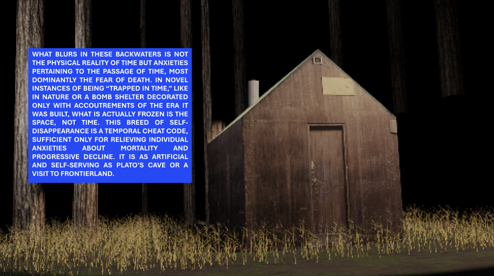
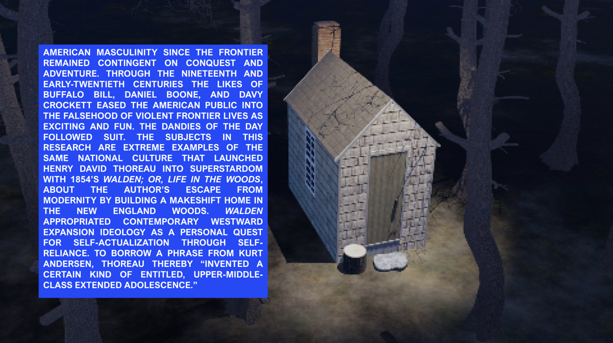
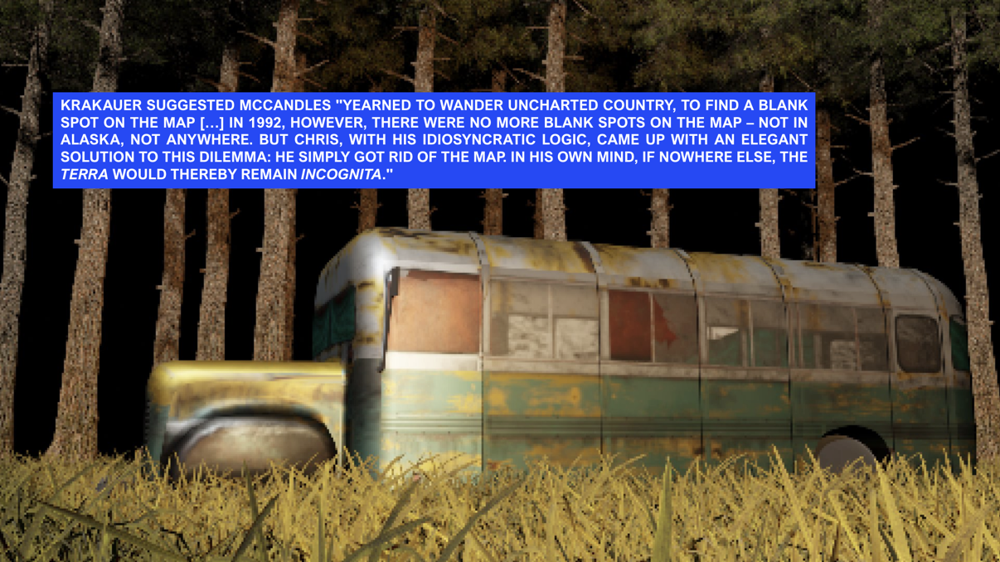
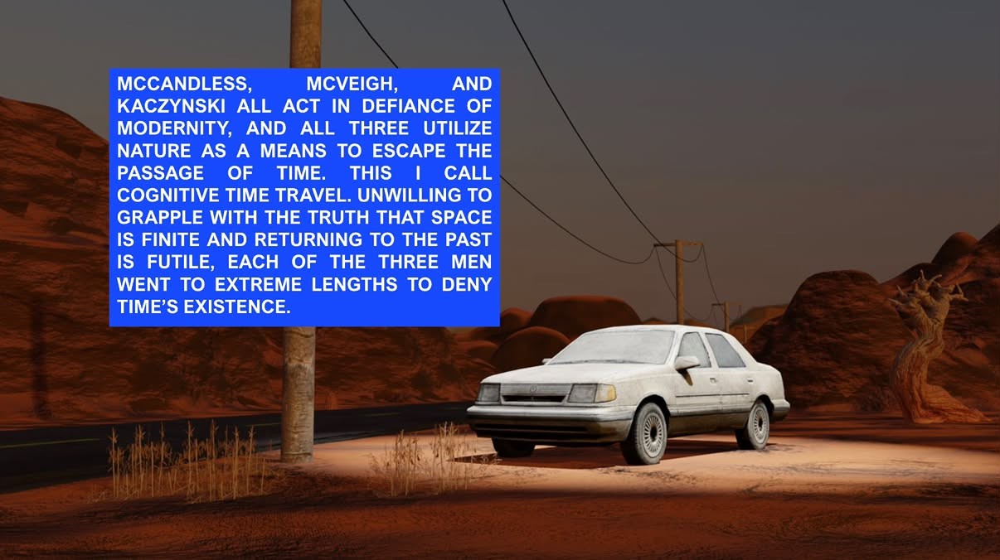
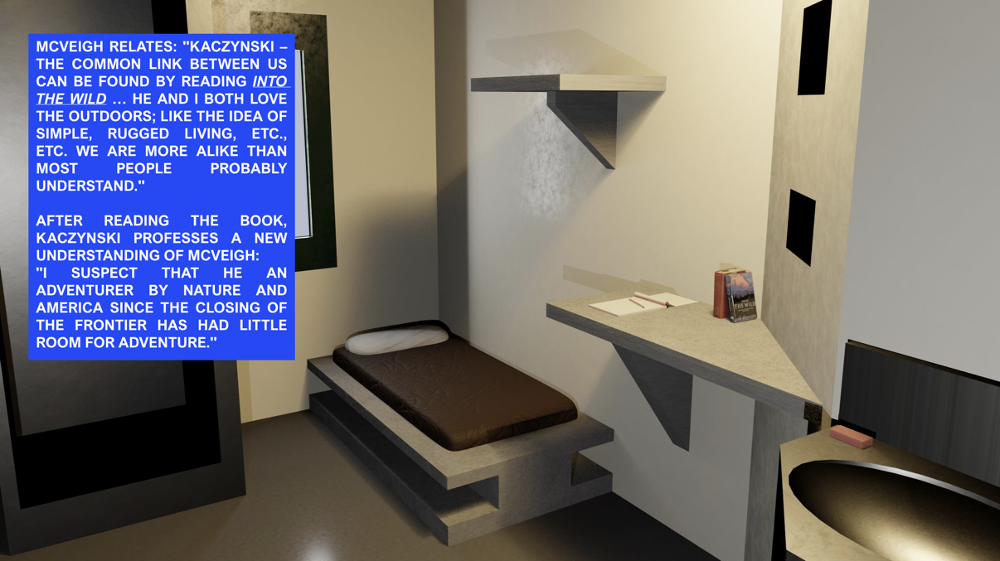

---
tag: project
--- 

I recently made the backgrounds for a panel at the American History Association conference, relating to Ted Kazynski, Timothy McVeigh, Chris McCandless, and their beliefs in back-to-the-land frontier-style living to escape modernity.

I used [this](https://sketchfab.com/3d-models/grungy-little-car-ba693b225f9a4070867ed3df3e59aebe) model of a car for one scene, because modeling cars is really hard and I banged these all out in an hour or two each.