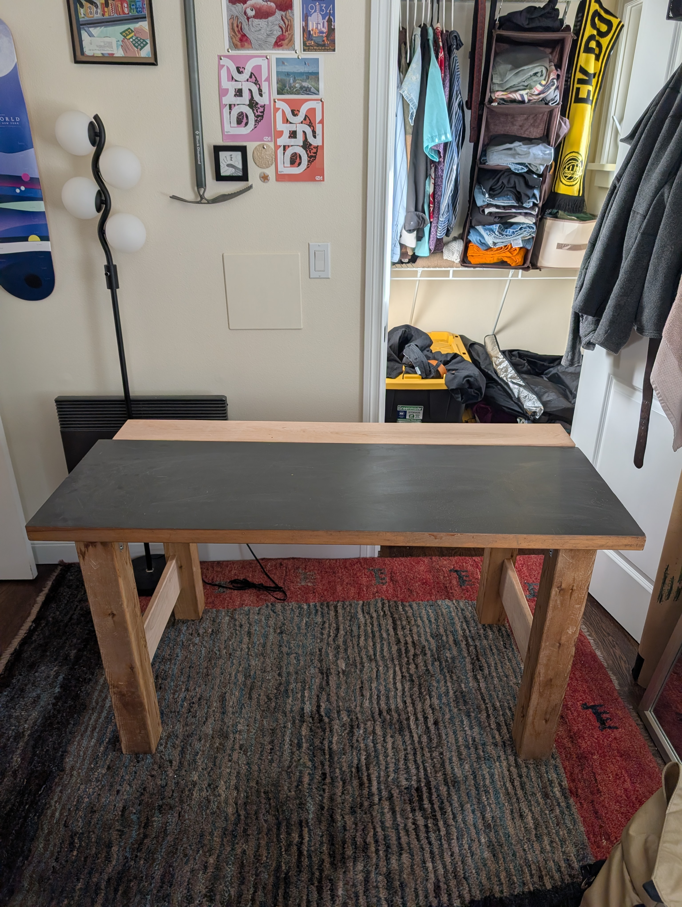
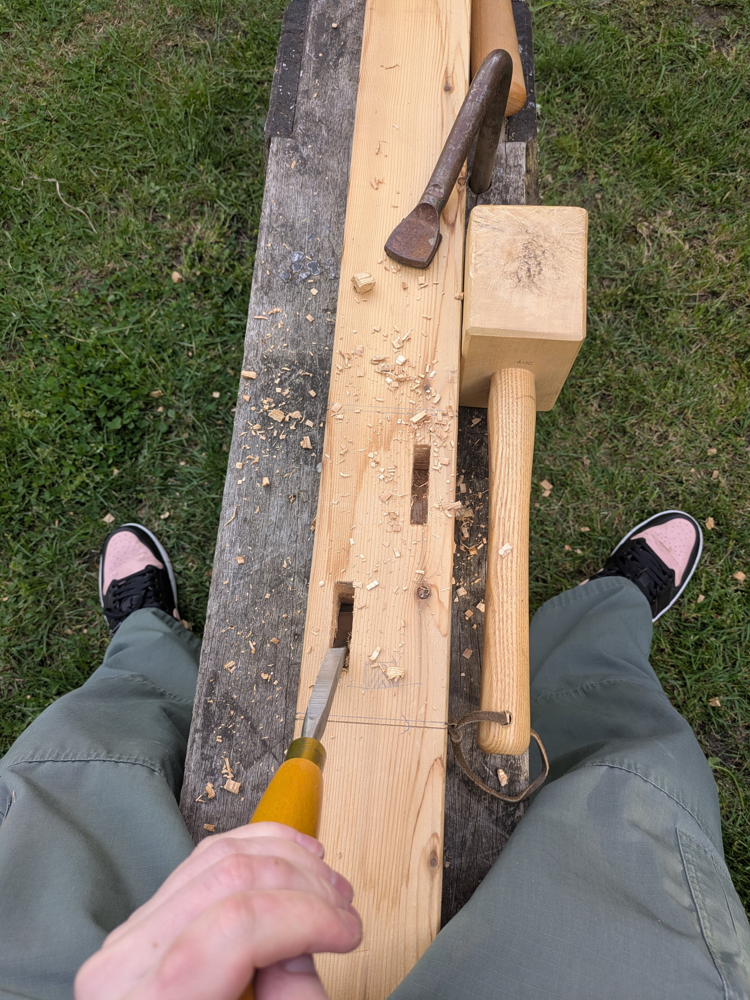
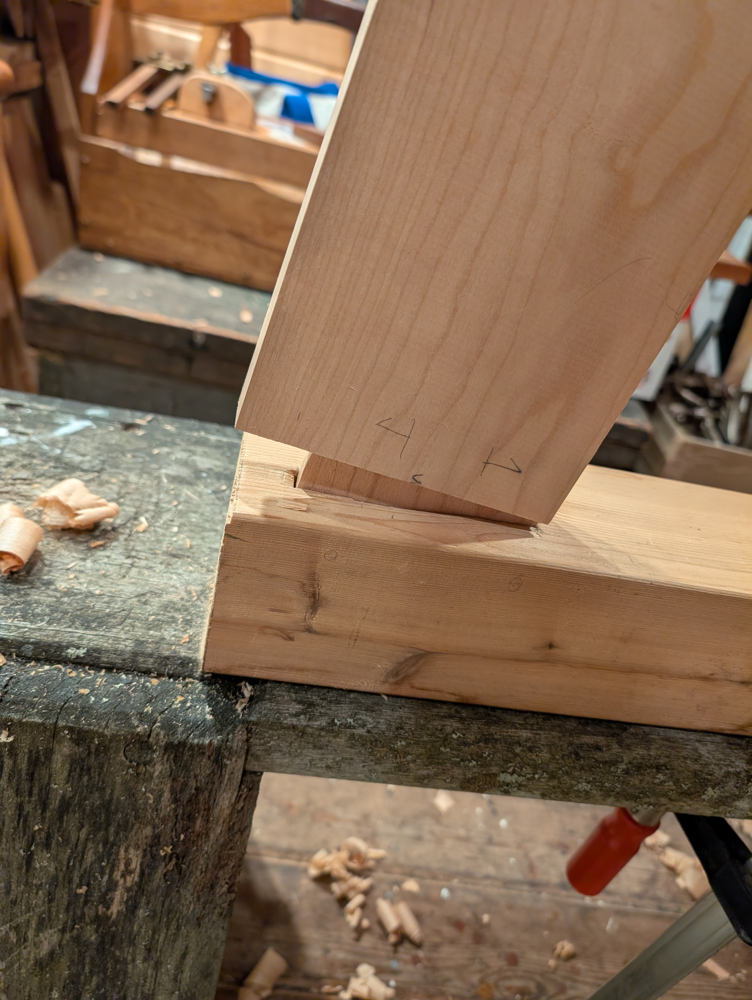
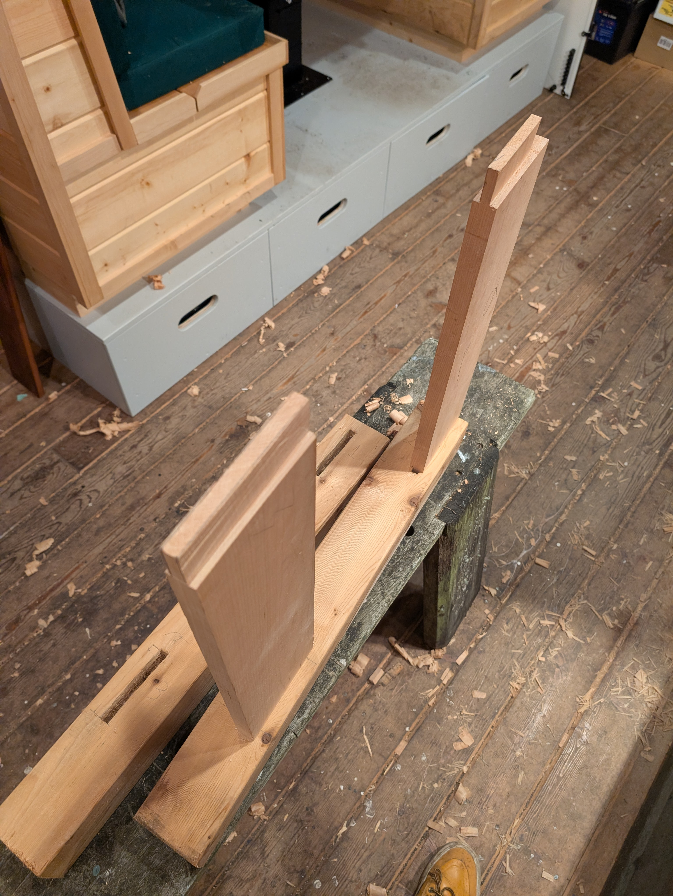
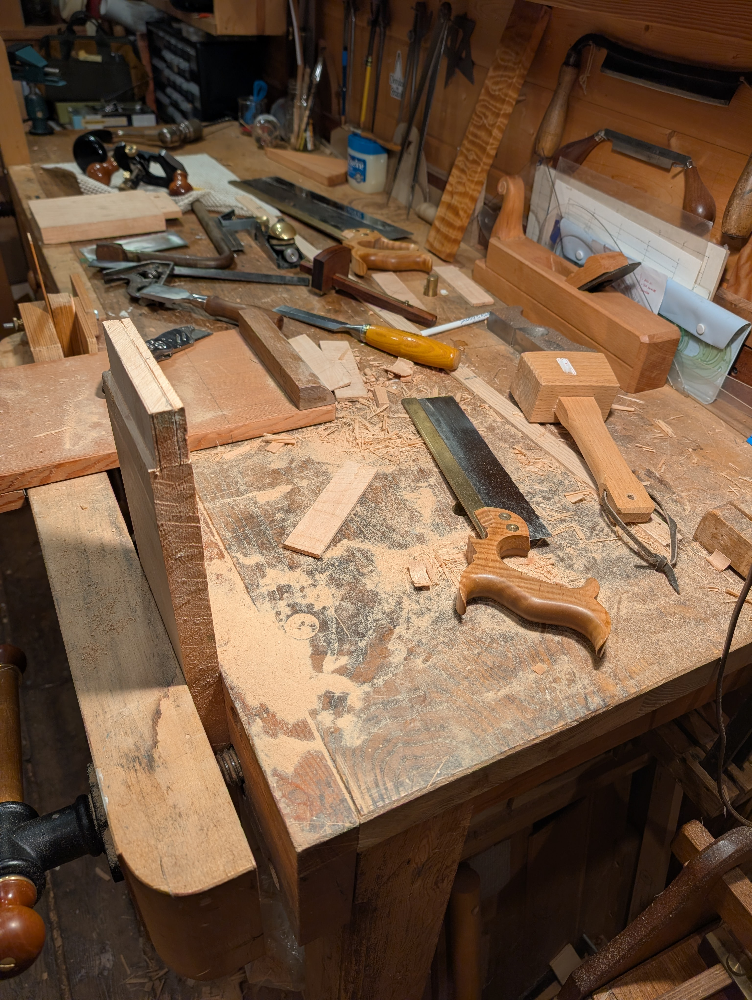
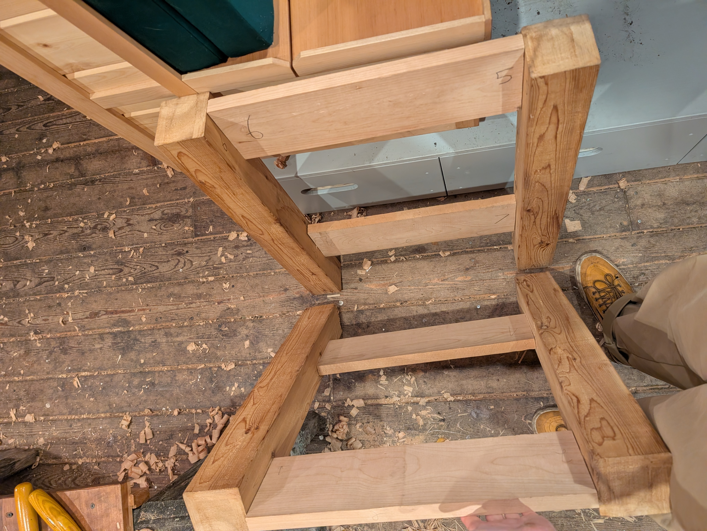
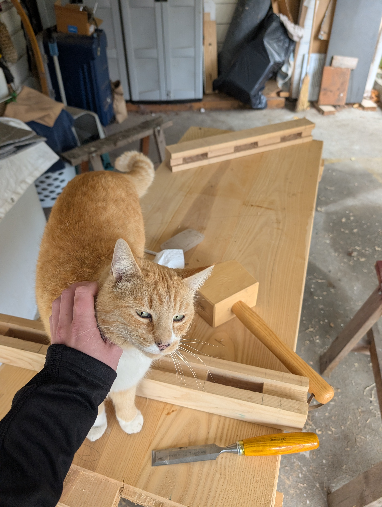

---
tag: project
--- 

I was tired of using my crappy amazon desk, so I decided to build one. With my dad's guidance, I did so using traditional mortise and tennon joinery. I exclusively used hand tools, which I found really enjoyable. It was a lot of fun, very satisfying to have it all come together, and occasionally frustrating trying to get things to fit. 

I also inherited all parts of a workbench with similar construction from a neighbor, but it's always harder to work on someone elses project than your own. Especially with something that can be as precise and frustrating as joinery, it makes a big difference if you are getting mad at your past self for messing something up vs. someone else. I'd always prefer it be myself. I will hopefully end up finishing that at some point, and posting it here, but it won't be until I have a slightly bigger space.

Here's a picture of the finished desk and the process:

