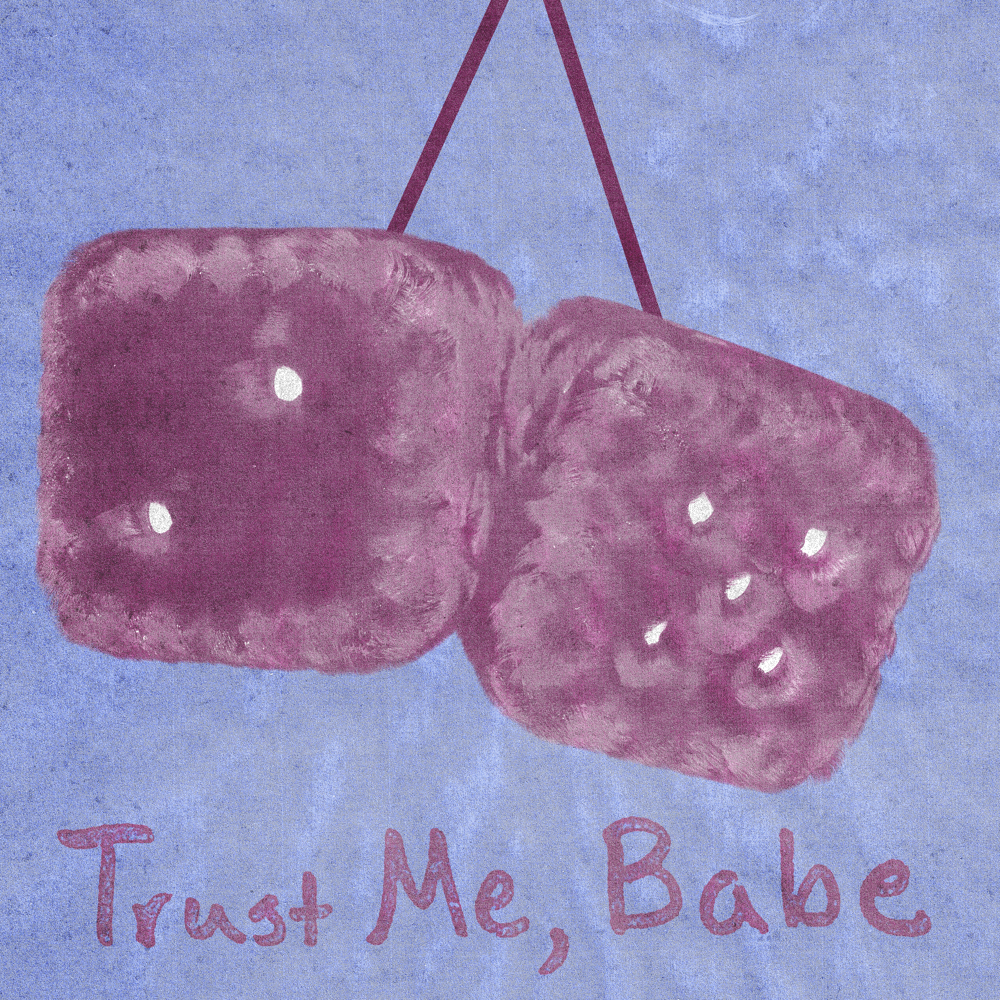
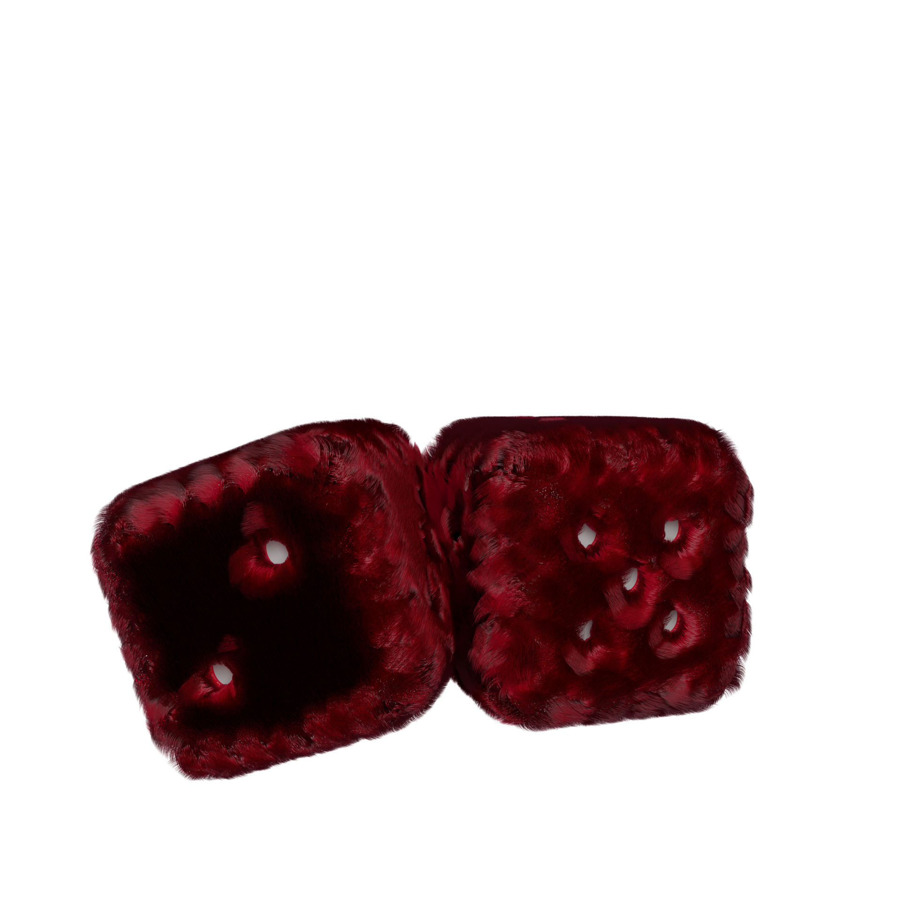

---
tag: project
--- 

I made an album cover for my friends single. I'm pretty proud of how it turned out. I started with a 3d render of a pair of fuzzy dice I made from scratch, and then overlayed a scan of her handwriting and a paper texture.

[Here's a link to the song on spotify](https://open.spotify.com/track/7AZnZ9lLnn3JRxVmlFGjsN?si=bf98d67432694146){:target="_blank"}

Here's a picture of it, and the render straight out of blender.

